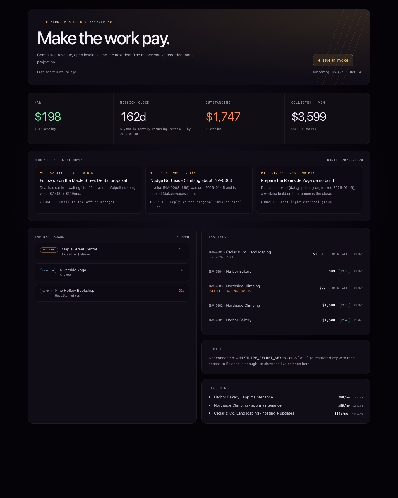
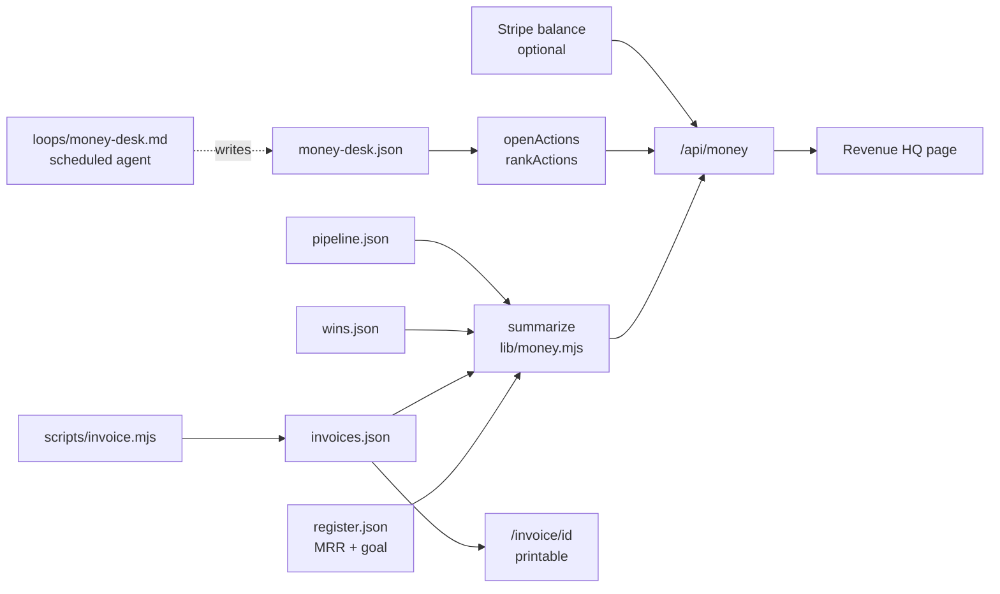

# Money Desk

A local revenue dashboard and invoicing tool for a one-person studio: recorded MRR, Net 14 invoices with printable pages, a deal board that flags stale deals, and a "money desk" that ranks the three moves most likely to bring in cash this month.



It started as the MONEY tab in the Business section of Omega, Ian's local operating dashboard, and is published here as a standalone Next.js app with fictional sample data.

## Why

A small studio's money questions are narrow: what is committed every month, who owes what, which deal has gone quiet, and what should I do today to get paid. A spreadsheet answers the first two and forgets the rest. This app answers all four from plain JSON files you own, and shows only money that was recorded, never a projection.

## Features

- **Revenue HQ**: MRR (active and pending), outstanding and overdue totals, collected plus awards, and a countdown to a revenue goal you set.
- **Invoices**: issue from a form, the API or the CLI. Numbers are `PREFIX-0001` (sequential) or `PREFIX-2026-001` (yearly reset). The next number is the highest existing one plus one, so deleting an invoice never causes a duplicate.
- **Net-N terms**: due date defaults to issue date + 14 days (`NET_DAYS`). Unpaid invoices past due are marked overdue.
- **Printable invoice page**: `/invoice/<id>` renders a plain paper-style invoice; print or save as PDF. Business name, contact and payment line come from env vars.
- **Line items**: send `items` and the total is their sum; a total that does not match its items is rejected.
- **Deal board**: open deals with days since they last moved; a week or more turns red.
- **Money desk**: shows the top three open actions from `data/money-desk.json`, ranked warm-before-cold, then by expected dollars per minute of your time. An agent loop writes that file (prompt in `loops/money-desk.md`).
- **Optional Stripe balance**: set a restricted `STRIPE_SECRET_KEY` and the live available/pending balance appears. Failures show as a message, never a broken page.
- **Read-only mode**: `READ_ONLY=1` disables writes for a public demo.

## How it works



All money rules (numbering, due dates, status, summary, ranking) are pure functions in `lib/money.mjs` with no file or network access. The API route, the invoice page and the CLI share them. `lib/store.mjs` reads `data/<file>` when you have one and falls back to `data/example/<file>`; writes always go to `data/` (git-ignored).

## Tech stack

Next.js 15 (App Router), React 19, TypeScript, Tailwind CSS 4 plus a CSS module, Node's built-in test runner. No database: JSON files on disk.

## Getting started

```bash
git clone https://github.com/ianroyes-sys/money-desk-invoicing.git
cd money-desk-invoicing
npm install
npm test            # 10 tests on the money logic
npm run dev         # http://localhost:3000, showing data/example
```

On the sample data the clock is pinned to the samples' date (2026-01-20) so overdue and stale flags read as intended. Once `data/invoices.json` exists (your first issued invoice creates it), the real date is used. `DEMO_NOW=YYYY-MM-DD` pins it explicitly.

To use your own records, copy the files you need from `data/example/` into `data/` and edit them, or start empty: the app works with no files at all. Configure your business in `.env.local` (see `.env.example`):

| Variable | Purpose |
| --- | --- |
| `BUSINESS_NAME`, `BUSINESS_TAGLINE`, `BUSINESS_EMAIL`, `BUSINESS_WEBSITE` | Header of the printed invoice |
| `PAYMENT_INSTRUCTIONS` | Payment line at the bottom of each invoice |
| `INVOICE_PREFIX`, `INVOICE_NUMBERING` | `INV` + `sequential` by default; `yearly` resets each January |
| `NET_DAYS` | Payment terms, default 14 |
| `STRIPE_SECRET_KEY` | Optional restricted key, read access to Balance |
| `MONEY_DATA_DIR` | Keep records outside the repo |
| `READ_ONLY` | `1` disables issuing and marking paid |

### CLI

```bash
npm run invoice -- list
npm run invoice -- new --client "Harbor Bakery" --amount 99 --note "App maintenance, February"
npm run invoice -- paid INV-0003
npm run invoice -- summary
```

### API

```
GET  /api/money                                        summary + invoices + deals + desk + stripe
POST /api/money { "action": "invoice", "client", "amount" | "items", "note"?, "due"? }
POST /api/money { "action": "paid", "id" }
```

Bad input returns `400 { error: "bad-invoice", detail }`; an unknown id returns `404`.

## Data format

```jsonc
// register.json: recurring revenue you have agreed, and the goal
{ "mission": { "goal": "$1,000 in monthly recurring revenue", "by": "2026-06-30" },
  "recurring": [ { "name": "Harbor Bakery · app maintenance", "amount": 99, "status": "active" } ] }
// invoices.json
[ { "id": "INV-0001", "client": "Harbor Bakery", "amount": 1500, "issued": "2025-11-10",
    "due": "2025-11-24", "paid": "2025-11-20", "items": [ { "desc": "…", "amount": 1500 } ] } ]
// pipeline.json: stage is lead | pitched | awaiting | won | lost; moved = last change
{ "deals": [ { "name": "Maple Street Dental", "stage": "awaiting", "value": "$2,400", "moved": "2026-01-08" } ] }
// wins.json: awards, prizes, grants
[ { "at": "2025-12-15", "name": "Pitch night", "amount": 500 } ]
```

`money-desk.json` is the agent's output; see `data/example/money-desk.json` and `loops/money-desk.md` for its shape.

## Project structure

```
app/
  page.tsx              Revenue HQ (client component)
  invoice/[id]/page.tsx Printable invoice
  api/money/route.ts    GET summary, POST invoice / paid
lib/
  money.mjs             Numbering, Net-N, status, summary, action ranking (pure)
  money.test.mjs        node:test suite
  store.mjs             JSON read/write with example fallback, business config, clock
  stripe.mjs            Optional balance lookup, fails soft
scripts/invoice.mjs     CLI over the same files
loops/                  Agent prompts: money-desk (active) and revenue (retired, kept for reference)
data/example/           Fictional studio, clients and invoices
docs/                   Screenshots from the sample data
```

## Status

Runs locally and builds with `npm run build`; the money logic is covered by tests. The screenshots in `docs/` are from `npm run start` on the sample data. In Omega this tab runs on real records and the money-desk loop runs each morning on a schedule; the loop runner itself is not part of this repo, so `loops/money-desk.md` is a prompt you can hand to any scheduled agent. All names, amounts and invoices here are fictional.

Built by [Ian Royes](https://github.com/ianroyes-sys)
